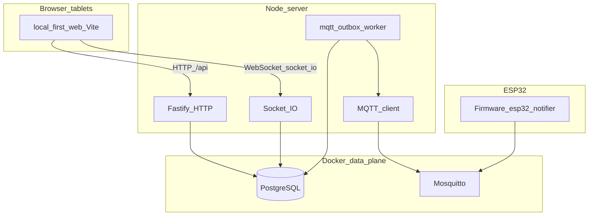

# Local-first KOT stack

This directory is a **parallel implementation** of the digiKOT restaurant system: designed to run **entirely on your LAN** (Postgres + Node + browsers + ESP32), with **no dependency on Supabase or Firebase** for this path.

**Long-form docs (onboarding / production / license):**

- [`docs/LOCAL_FIRST_IMPLEMENTATION_HISTORY.md`](docs/LOCAL_FIRST_IMPLEMENTATION_HISTORY.md) — first implementation wave: architecture, DB, MQTT outbox, dev workflow.
- [`docs/PRODUCTION_DOCKER_LICENSE_AND_WORKFLOWS.md`](docs/PRODUCTION_DOCKER_LICENSE_AND_WORKFLOWS.md) — Docker Option 3 Chunk 1, license strategy (current + planned), Git/secrets, how to run prod compose.
- [`docs/LAN_WIFI_ESP_RESTAURANT_TEST_PLAN.md`](docs/LAN_WIFI_ESP_RESTAURANT_TEST_PLAN.md) — Wi‑Fi router LAN test plan: laptop as server, tablet/phone clients, ESP32 MQTT, waiter-topic next steps.

The **existing app at the repository root** (`src/`, root `vite.config.js`, root `package.json`, Supabase client code) is intentionally **left alone**. When you work on local-first, you add or change files **only under `local-first/`**, so the legacy UI keeps working as today.

---

## What you get (high level)

| Layer | Technology | Role |
|--------|------------|------|
| Browser UI | Vite + React (`web/`) | New screens: health, devices, and (over time) waiter / kitchen / manager flows. Talks to the server over **HTTP** and **Socket.IO** only. |
| API + realtime | Fastify + Socket.IO (`server/`) | **Single source of truth** for business rules, auth, DB access, and pushing updates to tablets. |
| Database | PostgreSQL (Docker) | Durable state: staff, tables, KOTs, bills, **app notifications**, **device registry**, **MQTT outbox**. |
| Device transport | Mosquitto + MQTT | ESP32 and similar devices subscribe/publish on **versioned topics** (`kot/v1/...`). **Authenticated** from day one (no anonymous broker access in the default setup). |



---

## Repository layout (this folder)

| Path | What lives here |
|------|-----------------|
| [`docker-compose.yml`](docker-compose.yml) | **Postgres** + **Mosquitto** services for local/LAN dev. |
| [`.env.example`](.env.example) | Copy to **`.env`** (gitignored) and adjust secrets/ports. |
| [`db/migrations/`](db/migrations/) | **`node-pg-migrate`** entry files (for example `1715500000000_init.cjs`). |
| [`db/sql/`](db/sql/) | Large SQL bodies loaded by migrations (keeps migration JS small). |
| [`db/seed/`](db/seed/) | Optional dev seed (`dev_seed.sql`) applied with `npm run db:seed` from `server/`. |
| [`server/`](server/) | Fastify app: routes, services, DB pool, MQTT client, outbox **worker**, Socket.IO attachment. |
| [`web/`](web/) | Greenfield React UI; Vite dev server proxies `/api` and `/socket.io` to the API port. |
| [`mosquitto/`](mosquitto/) | Broker **Dockerfile** (generates `passwd` at **image build**), `mosquitto.conf`, **ACL** file. |
| [`nginx/`](nginx/) | Optional single-port LAN layout (static UI + reverse proxy); not wired into compose by default. |
| [`firmware/`](firmware/) | ESP32 topic contract and sketch stub (`esp32-notifier/`). |

---

## How the pieces work together

### 1. PostgreSQL (system of record)

All authoritative state lives in Postgres. The schema is created by **migrations**, not by hand-editing production DBs. Dev seeds give you users, tables, and a sample **device** row so `/devices` and the **test notification** path work immediately after migrate + seed.

**Important conceptual split:**

- **`notifications`** — **Human / app-visible** notification history (title, message, target, read/ack timestamps). Something can be recorded here even if MQTT is down or disabled for a deployment.
- **`mqtt_outbox`** — **Technical delivery queue** for the broker. Rows are written in the **same business transaction** as the domain change when you need an ESP to see an event; a **background worker** reads pending rows, publishes to MQTT, then marks them published (or retries / fails with `last_error`).

That separation keeps “what happened in the business” separate from “what we tried to push over the radio.”

### 2. Fastify (HTTP API)

Routes live under **`/api`** (for example `GET /api/health`, `GET /api/system/status`, `GET /api/devices`, `POST /api/devices/test-notification`). The server uses a **`pg` pool**; handlers should keep business logic in **`server/src/services/`** and thin route files under **`server/src/routes/`** as the codebase grows.

### 3. Socket.IO (browser realtime)

Socket.IO is attached to the **same HTTP server** as Fastify (`server/src/realtime/socketHub.js`). The Vite app connects through the **dev proxy** so the browser only talks to `http://localhost:5173` during development. On connect, the server emits a small `system:hello` event so you can confirm the pipe on **Local health** (`/local-health`).

Later, domain events (new KOT, status changes) will join rooms and push snapshots the same way—this stack is prepared for that pattern.

### 4. MQTT + outbox worker (ESP path)

When code decides an ESP must see something, it should:

1. **Commit the business change** in Postgres (orders, KOT state, etc.).
2. **Insert one or more `mqtt_outbox` rows** (`topic`, JSON `payload`, `status = pending`).
3. Let the **`mqttOutboxWorker`** (`server/src/workers/mqttOutboxWorker.js`) poll pending rows, **publish** via the shared MQTT client (`server/src/mqtt/mqttClient.js`), then update **`published_at`** / **`last_error`** / **`attempt_count`**.

If Mosquitto is restarting or the network glitches, **messages are not silently dropped**—they stay pending or fail with a visible error until retries exhaust (then `status = failed` for inspection).

### 5. Mosquitto (authenticated broker)

The image is **built locally** from [`mosquitto/Dockerfile`](mosquitto/Dockerfile): it runs `mosquitto_passwd` so username/password files exist **without** committing plaintext passwords into Git. Default build-time passwords match [`.env.example`](.env.example) (`kot_server` / `kot_dev_pass`, `esp_waiter_1` / `esp_dev_pass`). Change them by rebuilding with **Docker build args** or by maintaining your own image.

[`mosquitto/acl`](mosquitto/acl) restricts which users can read/write which topic prefixes (tighten per device in production).

### 6. Web UI (`web/`)

A **new** Vite + React app—not the root `src/` app. It uses:

- **`src/api/`** — small `fetch` helpers for `/api/...`.
- **`src/socket/`** — Socket.IO client factory.
- **`src/pages/`** — routes such as **Local health** and **Devices**.

Production build output is `web/dist/` (ignored by git). During dev, **Vite proxies** `/api` and `/socket.io` to the Node port (default **3000**).

---

## End-to-end: “Test notification” (today’s smoke test)

This is the **intentional early proof** that **DB → outbox → MQTT** works before the full KOT domain is ported.

1. In the UI (**`/devices`**), you click **Test notification** for a row in **`devices`** (seed includes `esp-waiter-1`).
2. The browser calls **`POST /api/devices/test-notification`** with `{ "deviceId": "esp-waiter-1" }`.
3. The server loads the device, then in **one transaction** inserts:
   - a **`notifications`** row (audit / in-app history), and  
   - an **`mqtt_outbox`** row targeting **`kot/v1/default/kitchen/events`** (see `server/src/topics.js`).
4. The **outbox worker** picks up the row, publishes JSON to Mosquitto, marks the row **published** (or records **`last_error`**).
5. An ESP subscribed to `kot/v1/default/kitchen/events` can **beep / display** (see [`firmware/README.md`](firmware/README.md)).

---

## Locked URLs (save this for tablet + ESP config)

| Mode | Web | HTTP API | MQTT broker |
|------|-----|----------|-------------|
| Dev on one machine | http://localhost:5173 | http://localhost:3000 | `127.0.0.1:1883` (or `SERVER_IP:1883` from another host) |
| LAN dev (same Wi‑Fi) | http://SERVER_IP:5173 | http://SERVER_IP:3000 | SERVER_IP:1883 |
| Single-port LAN (later) | http://SERVER_IP | Proxied via nginx | SERVER_IP:1883 |

Use a **DHCP reservation** or static IP for `SERVER_IP` on the machine that runs Docker.

---

## Prerequisites

- **Docker** (for Postgres + Mosquitto)
- **Node.js 18+** (20+ recommended)

---

## Setup and daily commands

### 1. Environment file

From the repo root:

```bash
cp local-first/.env.example local-first/.env
```

Edit **`local-first/.env`** if you change compose passwords, ports, or broker credentials.

| Variable | Purpose |
|----------|---------|
| `DATABASE_URL` | Postgres connection string (must match compose). |
| `PORT` | Fastify listen port (default **3000**). |
| `LISTEN_HOST` | Bind address; default **`0.0.0.0`** for LAN tablets. Use **`127.0.0.1`** only if your environment errors on `os.networkInterfaces()` during Fastify’s listen log. |
| `MQTT_URL` / `MQTT_USER` / `MQTT_PASSWORD` | Server → broker connection (must match Mosquitto image). |
| `DEFAULT_RESTAURANT_ID` | Single-tenant default; **`default`** matches seed and topics. |

### 2. Start Docker services

```bash
docker compose -f local-first/docker-compose.yml up -d
```

- **Postgres** container name: **`kot-postgres`**, database **`kot_local`**, user **`kot`**.
- **Mosquitto**: custom image from **`local-first/mosquitto`**.

### 3. Migrations and seed

```bash
cd local-first/server
npm install
npm run db:migrate
npm run db:seed
```

- **`db:migrate`** — applies [`db/migrations/`](db/migrations/) via **`node-pg-migrate`** (reads SQL from [`db/sql/`](db/sql/)).
- **`db:seed`** — loads [`db/seed/dev_seed.sql`](db/seed/dev_seed.sql) (dev staff with `users.username`, tables, sample device). If you migrated before `username` existed, run **`npm run db:migrate`** again so [`1715600000000_add_users_username.cjs`](db/migrations/1715600000000_add_users_username.cjs) applies, then **`npm run db:seed`**.

### 4. Run the API (terminal 1)

```bash
cd local-first/server
npm run dev
```

### 5. Run the web app (terminal 2)

```bash
cd local-first/web
npm install
npm run dev
```

Open **http://localhost:5173** — try **Local health** and **Devices**.

### Production-style web build (optional)

```bash
cd local-first/web
npm run build
```

Serve `web/dist/` via nginx later; see [`nginx/nginx.conf`](nginx/nginx.conf) for a starting point.

---

## Database backup and restore

Do this **from early testing onward** so a Docker volume wipe does not cost you a long-lived dev dataset.

**Backup**

```bash
docker exec -t kot-postgres pg_dump -U kot kot_local > backup.sql
```

**Restore**

```bash
cat backup.sql | docker exec -i kot-postgres psql -U kot kot_local
```

---

## MQTT topic map (version **v1**)

Topics are prefixed with **`kot/v1/{restaurantId}/`** so firmware can stay on **v1** while the server evolves.

| Topic | Typical use |
|-------|-------------|
| `kot/v1/{rid}/kitchen/events` | Kitchen-wide feed (includes test notifications today). |
| `kot/v1/{rid}/waiter/{waiterId}/events` | Waiter-targeted events. |
| `kot/v1/{rid}/table/{tableNumber}/events` | Table-targeted events. |
| `kot/v1/{rid}/device/{deviceId}/status` | Device → server heartbeat / RSSI (ingestion to be wired). |
| `kot/v1/{rid}/device/{deviceId}/ack` | Device → server acknowledgements. |

In topics, **`deviceId`** is the string column **`devices.device_id`** (e.g. `esp-waiter-1`), not the internal UUID **`devices.id`**.

Payloads are JSON with at least **`"v": 1`**. Details and ESP notes: [`firmware/README.md`](firmware/README.md).

---

## Troubleshooting

| Symptom | Things to check |
|---------|------------------|
| `ECONNREFUSED` on Postgres | Compose up? Port **5432** free? `DATABASE_URL` host is **`localhost`** or **`127.0.0.1`** from the host, not `kot-postgres` unless you run Node inside Docker. |
| MQTT never **connected** | Broker up? `MQTT_URL` / user / password match the **built** Mosquitto image? Firewall on **1883**? |
| Outbox rows stay **pending** | Worker only publishes when **`mqtt.connected`** is true; check **`GET /api/system/status`**. |
| Fastify crashes on **listen** | Set **`LISTEN_HOST=127.0.0.1`** in `.env` (some restricted environments break interface enumeration when binding `0.0.0.0`). |
| Tablets cannot reach API | **`LISTEN_HOST=0.0.0.0`**, use LAN IP in URLs, ensure Vite **`server.host`** / firewall if you run Vite on a second machine (advanced). |

---

## What is intentionally not done yet

The scaffold prioritizes **infra + DB shape + health + devices + MQTT outbox + test publish**. Still to grow (using the root app’s `src/services` and `src/repositories` as a **behavioral spec**, not by importing browser code):

- Full **PIN / session auth** and role-gated routes.
- **Menu, tables, sessions, KOT lifecycle, billing, cancellations, audit** on the server.
- Rich **Socket.IO** rooms and snapshot-on-connect for each role.
- **`/devices`** registration flows, heartbeat ingestion, ACK persistence.
- **Signed license** enforcement (Chunk 2): verify on startup, guarded routes, Socket.IO.

---

## Production Docker (Option 3 — Chunk 1)

Four services only: **postgres**, **mosquitto**, **server**, **nginx**. The **nginx** image builds [`web/`](web/) and serves **`dist/`** while proxying **`/api`** and **`/socket.io`** to the server. **Postgres is not published** to the LAN; **nginx** exposes **80**, **Mosquitto** exposes **1883**. There is **no separate `web` container**.

**`license.key` is never baked into an image.** At runtime, compose bind-mounts `./license` read-only at `/app/license` on the server (Chunk 2 will read and verify it).

### Files

| File | Role |
|------|------|
| [`server/Dockerfile`](server/Dockerfile) | Production Node image: `npm ci --omit=dev`, copy app + [`db/`](db/) to `/db`, run as **non-root** `nodejs`, entrypoint runs migrations then `node src/app.js`. |
| [`nginx/Dockerfile`](nginx/Dockerfile) | Multi-stage: build web, copy **`dist/`** into nginx; **no source maps** (`vite.config.js` sets `build.sourcemap: false`). |
| [`nginx/nginx.prod.conf`](nginx/nginx.prod.conf) | Static SPA + reverse proxy to `server:3000`. |
| [`docker-compose.prod.yml`](docker-compose.prod.yml) | Production compose; volumes for Postgres data and backups; **`./license:/app/license:ro`**. |
| [`deploy/.env.example`](deploy/.env.example) | Copy to **`deploy/.env`**; set secrets and `DATABASE_URL` (host **`postgres`** inside compose). |

### Build images (from `local-first/`)

```bash
docker build -f server/Dockerfile -t digikot-server:1.0.0 .
docker build -f nginx/Dockerfile -t digikot-nginx:1.0.0 .
```

Compose can build the same tags:

```bash
cp deploy/.env.example deploy/.env
# Edit deploy/.env: POSTGRES_*, DATABASE_URL, MQTT_*, strong passwords
mkdir -p license
# Place license.key in license/ when Chunk 2 is available (optional for Chunk 1 smoke test)

docker compose -f docker-compose.prod.yml --env-file deploy/.env build
docker compose -f docker-compose.prod.yml --env-file deploy/.env up -d
```

Open **http://SERVER_IP/** (port **80**) from a tablet on the same LAN. API calls go to **`/api/...`** on the same origin. MQTT clients use **SERVER_IP:1883**.

### Assumptions (Chunk 1)

- **Mosquitto** reuses the existing dev [`mosquitto/`](mosquitto/) image build (passwd baked at image build); production still bind-mounts **`mosquitto.conf`** and **`acl`** from the host bundle (config files, not app source).
- **Migrations** run on every server start when **`RUN_MIGRATIONS_ON_START=1`** (default in `.env.example`); set to **`0`** after you pin migrations to a release process if you prefer.
- **CORS** for the API uses **`origin: true`** when **`NODE_ENV=production`** so tablets hitting the LAN IP through nginx work without enumerating every subnet.

---

## Related docs

- Deep dive: local-first history — [`docs/LOCAL_FIRST_IMPLEMENTATION_HISTORY.md`](docs/LOCAL_FIRST_IMPLEMENTATION_HISTORY.md)
- Deep dive: production Docker + license workflows — [`docs/PRODUCTION_DOCKER_LICENSE_AND_WORKFLOWS.md`](docs/PRODUCTION_DOCKER_LICENSE_AND_WORKFLOWS.md)
- LAN + Wi‑Fi + ESP restaurant test plan — [`docs/LAN_WIFI_ESP_RESTAURANT_TEST_PLAN.md`](docs/LAN_WIFI_ESP_RESTAURANT_TEST_PLAN.md)
- Root functional write-up (product behavior reference): [`../FUNCTIONALITY_DEEP_DIVE.md`](../FUNCTIONALITY_DEEP_DIVE.md)
- ESP topic and sketch notes: [`firmware/README.md`](firmware/README.md)
